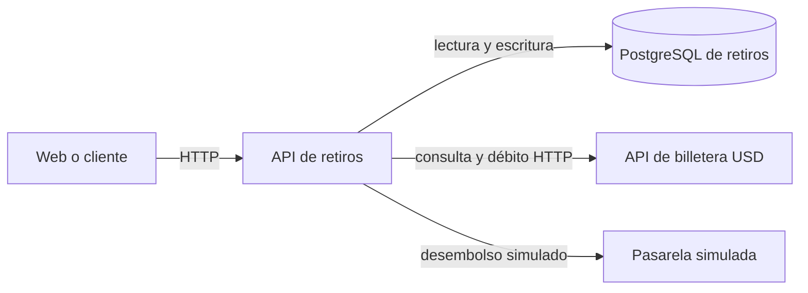
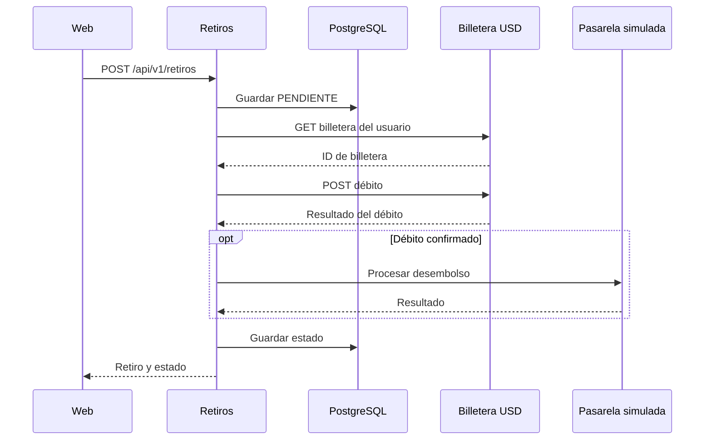

# Arquitectura del sistema de retiros USD

La web llama a `POST /api/v1/retiros`. Retiros guarda la solicitud, busca la billetera del usuario, solicita el débito y, si se confirma, procesa la pasarela simulada. La API responde con el estado y permite consultas por ID o usuario.

El estado puede ser `COMPLETADO`, `RECHAZADO`, `FALLIDO` o `PENDIENTE`. La respuesta `201` indica que la solicitud se registró, no que siempre se completó. El débito incierto exige revisión manual; la devolución tras un fallo de pasarela es manual.
