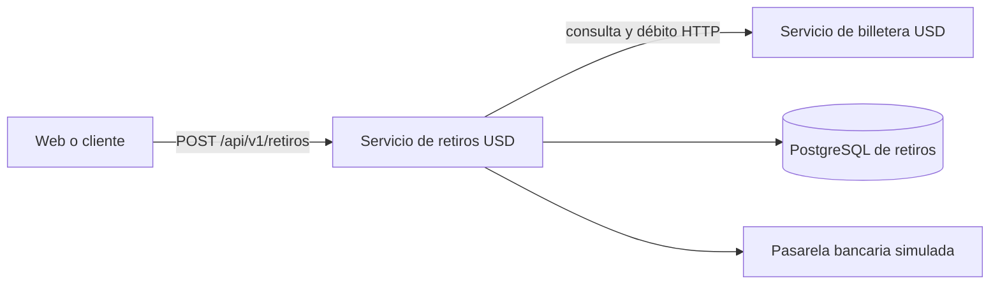

# Integración de microservicios para el taller

El servicio de retiros USD es responsable de registrar y procesar el retiro. Billetera mantiene su propio saldo y ofrece operaciones HTTP para consultar la billetera de un usuario y solicitar un débito.

## Responsabilidades y límites

- La web solicita el retiro a la API de retiros, no necesita llamar directamente al débito de billetera.
- Retiros conserva el estado e identificadores en su propia base de datos.
- Billetera confirma o rechaza el débito. El identificador de usuario debe coincidir con su `user_id`.
- La pasarela es simulada; no se realiza un desembolso bancario real.
- La integración no documenta reversión ni idempotencia del débito. Los casos inciertos requieren revisión manual.

Para los endpoints concretos, véase [el flujo con direcciones de prueba](../testing/validacion-retiros/1-flujo-endpoints-billetera-usd.md). Para despliegue, véase [Kubernetes](../../k8s/README.md).
